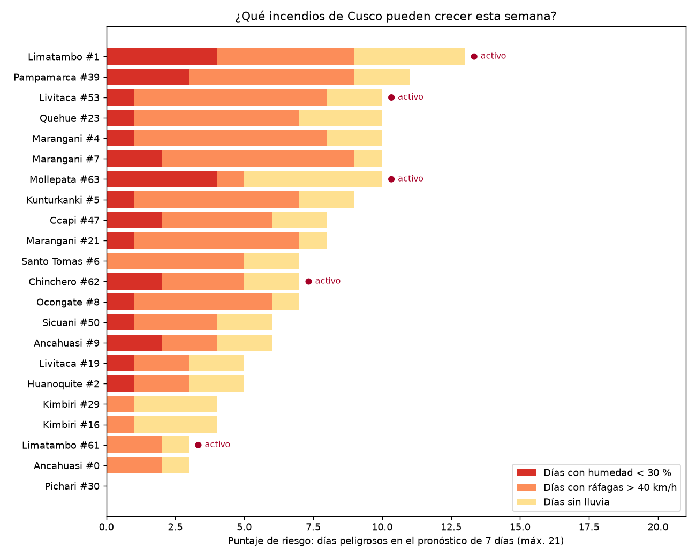
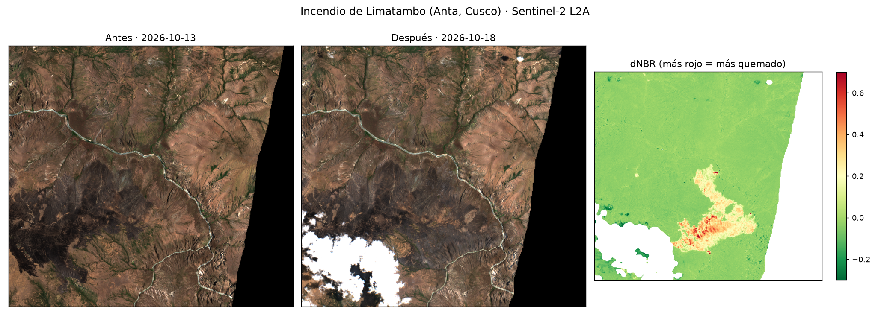
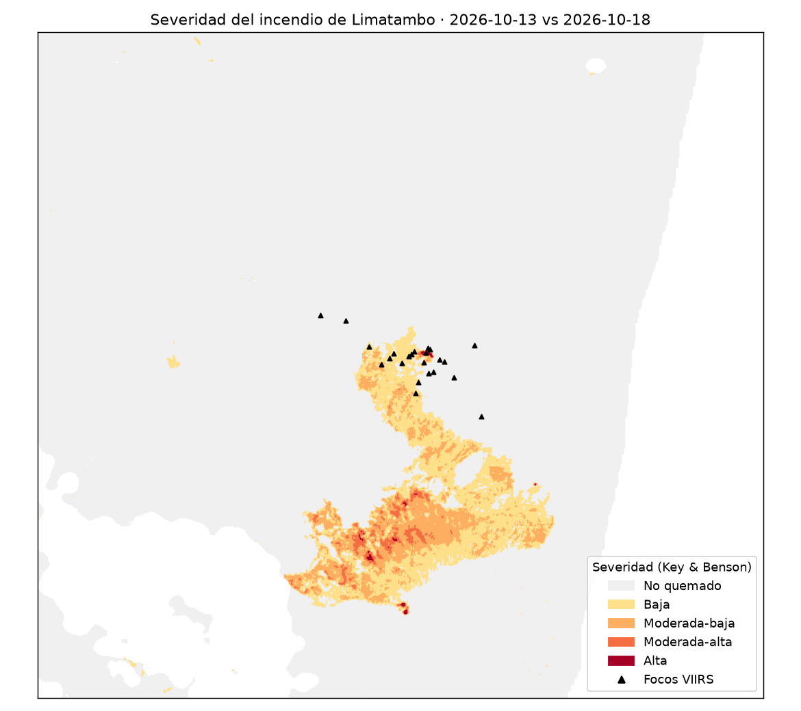

# ¿Qué incendios de Cusco pueden crecer esta semana?

**Reto F · Clima y riesgo** · Sesión 14, Ciencia de Datos con Python · Jhanela Carhuaz · 21 de octubre de 2026

Cruzo los incendios activos de Cusco con el pronóstico del tiempo para ordenar
cuáles tienen más probabilidad de crecer en los próximos 7 días. Luego mido con
Sentinel-2 cuánto quemó el primero del ranking.



## Tres hallazgos

1. **El incendio de Limatambo (Anta) es el que más puede crecer: 13 de 21 puntos.**
   Sigue activo, lleva **14 días seguidos sin lluvia** (0,3 mm en dos semanas) y
   el pronóstico trae humedad de hasta **19 %** y ráfagas de hasta **64 km/h**.
   Los incendios de Canas y Canchis tienen viento parecido, pero llovió hace
   poco (5 a 9 mm en 14 días). Los tres incendios con 14 días secos están todos
   en Anta y Paruro, del lado del cañón del Apurímac.

2. **Limatambo ya quemó unas 330 ha entre el 13 y el 18 de octubre**
   (dNBR ≥ 0,27). Con otra fecha posterior (17 oct) da 329 ha, casi lo mismo. El
   umbral pesa mucho más que la fecha: con 0,10 son 845 ha y con 0,44 solo 46 ha.
   La mayor parte es de severidad baja (513 ha) y moderada-baja (287 ha).

3. **Los focos de calor no ven todo el incendio.** Los focos VIIRS están en el
   extremo norte de la cicatriz, pero la parte más severa está unos 3 a 4 km al
   sur, donde casi no hubo focos. Con 2 km de margen alrededor de los focos (lo
   que se suele hacer), la zona de estudio cortaba la cicatriz y daba 163 ha, la
   mitad del área real.





## Datos y fechas

| Dato | Fuente | Fechas |
|---|---|---|
| Focos de calor VIIRS (S-NPP y NOAA-20) | NASA FIRMS, CSV "South America 7d", sin clave | 14 al 21 oct 2026 |
| Límites distritales con ubigeo | GitHub `juaneladio/peru-geojson` | — |
| Clima diario: humedad mínima, ráfagas, lluvia, temperatura | Open-Meteo, sin clave | 14 días pasados + 7 de pronóstico desde el 21 oct |
| Sentinel-2 L2A, bandas B8A, B12, SCL y color real | Microsoft Planetary Computer | antes 13 oct, después 18 oct (y 17 oct para comparar) |

## Método

1. **Focos → incendios.** Saco los focos de confianza baja. Dos focos son el
   mismo incendio si están a 1 km o menos y a 48 h o menos (en UTM 18S, para
   medir en metros). Cusco: 412 focos, 98 incendios; analizo los 22 con 5 focos o más.
2. **Clima.** Pido a Open-Meteo el clima diario en el centro de cada incendio.
3. **Puntaje de riesgo (0 a 21).** Por cada día del pronóstico sumo 1 si la
   humedad mínima es menor a 30 %, 1 si las ráfagas pasan de 40 km/h y 1 si
   llueve menos de 1 mm. Es la "regla 30-30-30" de los bomberos forestales
   adaptada a la sierra: quito la temperatura porque a unos 3 500 m casi nunca
   pasa de 30 °C (la mediana aquí es 18 °C).
4. **Imágenes.** Zona de estudio = rectángulo de los focos + 5 km. Para cada
   imagen mido el % de nubes **dentro de la zona** con la capa SCL; el % de la
   escena engaña (el 18 oct la tesela LYL tenía 74 % de nubes y la zona solo 2 %).
5. **dNBR.** NBR = (B8A − B12) / (B8A + B12) a 20 m, restando el offset de 1000
   (línea base 05.13). dNBR = NBR antes − NBR después. Enmascaro sin dato, sombras,
   agua, nubes y cirros con SCL. Severidad según Key & Benson (2006).
6. **Sensibilidad.** Repito con la imagen del 17 oct y con umbrales 0,10, 0,27 y 0,44.

Todas las decisiones están en [`src/config.py`](src/config.py).

## Cómo reproducirlo

```bash
uv sync
uv run src/00_descargar.py
uv run src/01_incendios.py
uv run src/02_clima.py
uv run src/03_riesgo.py
uv run src/04_sentinel.py
uv run src/05_dnbr.py
uv run src/06_mapas.py
uv run streamlit run app.py
```

Los focos FIRMS de "7 días" cambian cada día: si lo corres otro día saldrán
otros incendios. Este análisis es del 21 de octubre de 2026.

## Limitaciones

- **Un foco de calor no es un incendio.** Un incendio aparece como muchos focos
  y, como muestra el hallazgo 3, puede quemar zonas donde no hubo ningún foco.
  También puede haber focos que son quemas agrícolas controladas.
- **Las nubes y el humo esconden el fuego.** El 20 de octubre la zona estaba
  100 % cubierta. En la imagen del 18 hay una nube al suroeste y una franja sin
  dato al este (borde de la pasada); ninguna toca la cicatriz, pero esos píxeles
  no se cuentan.
- **El pronóstico es de una celda de unos 11 km** y no ve el viento de valle ni
  la pendiente, que en el cañón del Apurímac importan mucho.
- **El puntaje no está validado.** Es una regla razonable, no un modelo
  entrenado con incendios que crecieron. Tampoco considera el tipo de vegetación.
- **El umbral cambia mucho el área** (de 46 a 845 ha). Reporto 0,27, el valor
  estándar, pero no lo validé en campo.
- El incendio sigue activo: las 332 ha son hasta el 18 de octubre.

Herramienta de práctica para el curso; no reemplaza los reportes de COEN, INDECI, SERFOR ni SERNANP.
